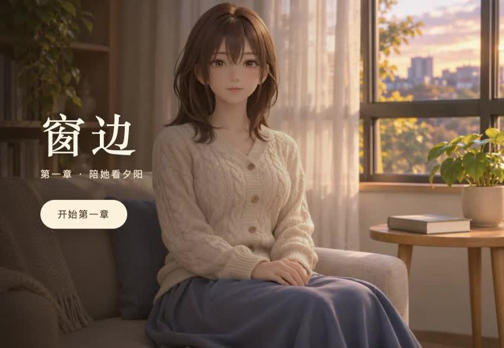

# Window Side

[简体中文](README.md)

**[52-second gameplay demo](https://github.com/jakelihua/window-side-showcase/releases/tag/demo-v0.1) · [Download MP4](https://github.com/jakelihua/window-side-showcase/releases/download/demo-v0.1/window-side-gameplay-demo.mp4)**

The cover and demo include AI-generated visuals and synthesized speech.

As sunset spills into the living room, you can look out the window with her or tell her how your day went.

Window Side is a Mandarin-language voice companion game in development. Your story begins in a living room overlooking the city skyline.

## Watch the Sunset

- Look out the window together, or sit back and talk about your day.
- She waves while waiting for you to speak. You can also trigger a head scratch from the interaction menu.
- The sunset you watch together can come up the next time you talk.
