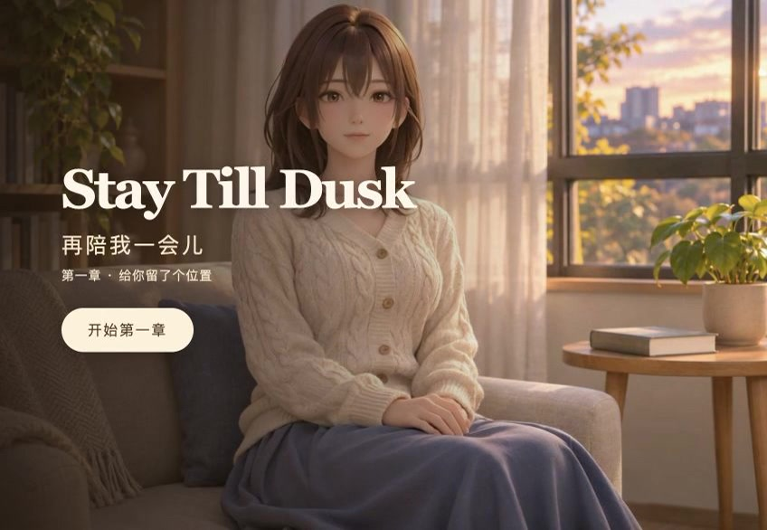

# Stay Till Dusk · 再陪我一会儿

[English](README.en.md)

**[55 秒实机演示](https://github.com/jakelihua/window-side-showcase/releases/tag/demo-v0.2) · [下载 MP4](https://github.com/jakelihua/window-side-showcase/releases/download/demo-v0.2/stay-till-dusk-gameplay.mp4)**

你回到窗边的客厅，Mira（米拉）给你留了个位置。太阳快落下去了，她想和你一起多坐一会儿。

《Stay Till Dusk》是一款正在开发的中文 AI 女友剧情游戏。你和 Mira 已经在交往。你们可以慢慢聊聊今天，也可以安静地一起看窗外。

## 第一章 · 给你留了个位置

陪 Mira 看一会儿夕阳，或先说说你今天过得怎么样。你也可以打字聊天，听她用普通话回应。一起看过的夕阳，会成为下次聊天时可以接上的共同经历。

展示画面含 AI 生成内容，演示配音由 AI 合成。
